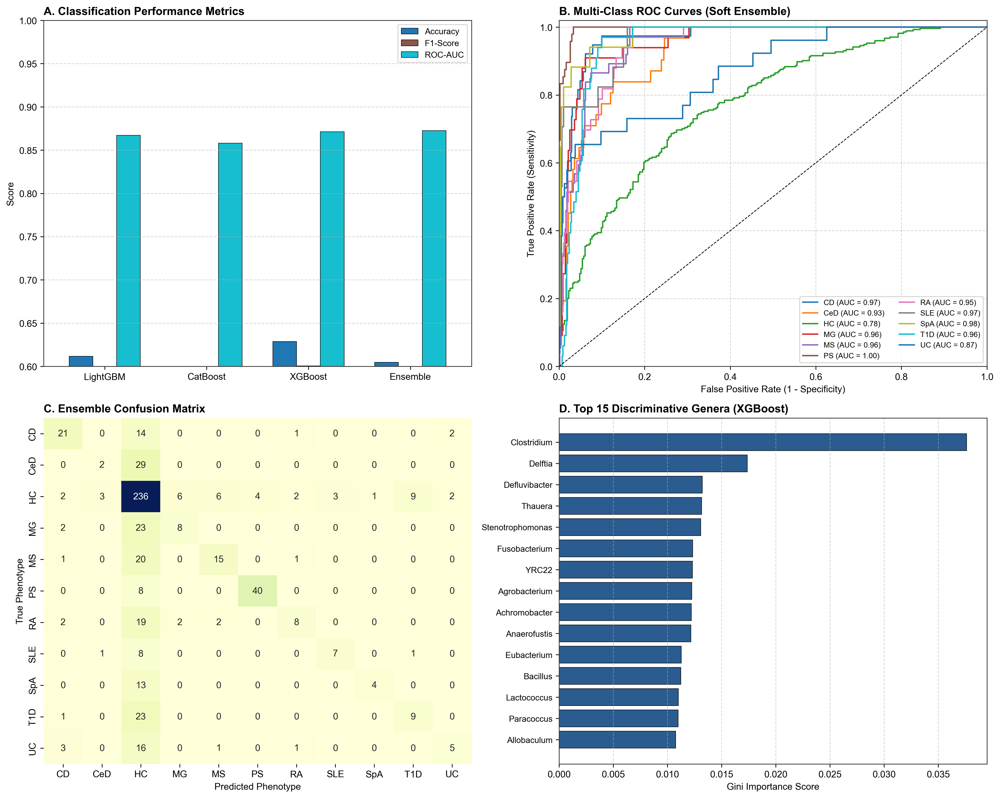

# AI-Driven Ensemble Machine Learning Framework for Multi-Class Autoimmune Disease Classification

Gut microbiome–based classification of 11 phenotypic classes (10 autoimmune conditions + healthy controls) using gradient-boosting models and a soft-voting ensemble.

*Internship project, Jamia Hamdard (MCAI).*

## Project Overview

Dysbiosis of the gut microbiota is closely linked to immune dysregulation and autoimmune disease. Instead of single-disease comparisons, this project builds one unified model that distinguishes many autoimmune disorders at once, using genus-level microbial abundance profiles.

- **Samples:** 1,955 across 11 classes (CD, CeD, HC, MG, MS, PS, RA, SLE, SpA, T1D, UC)
- **Features:** 423 gut microbial genera (abundance profiles)
- **Models compared:** XGBoost, LightGBM, CatBoost, Soft Voting Ensemble
- **Tuning:** Optuna hyperparameter optimisation with stratified 5-fold CV
- **Output:** Evaluation plots and feature-importance analysis to identify key discriminating taxa

## Repository Structure

```
├── main.py                  # full pipeline: load, tune, train, evaluate, plot
├── Dataset.xlsx             # genus-level abundance data
├── evaluation_results.png   # output figure
├── requirements.txt
└── README.md
```

## How to Run

```bash
git clone https://github.com/amanzehra18-oss/MCAI_INTERN.git
cd MCAI_INTERN
pip install -r requirements.txt
python main.py
```

## Results




## My Contribution

- Studied the biological background of gut dysbiosis and autoimmune diseases and wrote the Introduction and Discussion of the project report
- Worked on [data preparation / running and comparing XGBoost, LightGBM, CatBoost and the Soft Voting Ensemble]
- Interpreted the feature-importance results (e.g. Clostridium, Fusobacterium) in the context of immune regulation and gut microbiota
- Co-authored the final project report with my teammate Mohammad Younus under the supervision of Dr. Hira Javed, Jamia Hamdard

## Dataset

Data from An et al. (2025), "Gut microbiota analysis reveals microbial signature for multi-autoimmune diseases based on machine learning model", Frontiers in Microbiology, 16. https://doi.org/10.3389/fmicb.2025.1660775

## Team

Developed as a group internship project with [Mohammad Younus Anis](https://github.com/MOHDYOUNUSANIS).
